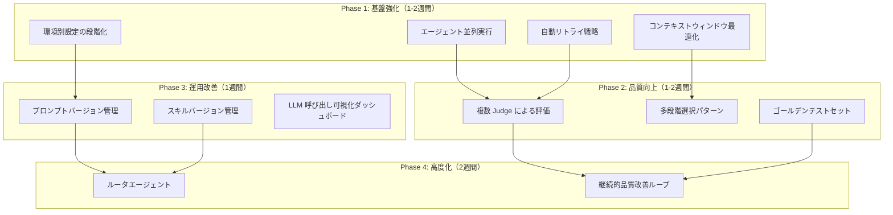

# 🚀 edu-creator 改善実装ロードマップ

> 実務プロジェクトから学んだ LLM エンジニアリングベストプラクティスの統合計画

## 目的の再確認

**edu-creator のミッション**: プログラミング初心者向けチュートリアルを、リポジトリから自動調査・執筆・品質管理・PDF出力するエンドツーエンドシステム。

## 改善提案の選別結果

16個の改善提案から、edu-creator の目的に合致し、かつ実装価値の高いものを **12個** 選別しました。

### ✅ 採用（14項目）

| カテゴリ | 項目 | 理由 |
|---------|------|------|
| **基盤強化** | エージェント並列実行 | 処理速度 30-40% 削減、教材生成の高速化 |
| **基盤強化** | コンテキストウィンドウ最適化 | トークンコスト 20-30% 削減、品質維持 |
| **基盤強化** | 自動リトライ戦略の高度化 | API障害時の自動回復、安定性向上 |
| **品質向上** | 複数 Judge による多角的評価 | 評価バイアス削減、品質の客観性向上 |
| **品質向上** | 多段階選択パターン | 複雑なセクション生成の段階的分解、品質向上 |
| **品質向上** | ゴールデンテストセット + リグレッション検知 | 品質後退の即座検知、CI/CD 統合 |
| **運用改善** | プロンプトのバージョン管理 + A/B テスト | プロンプト改善の科学的検証、改善サイクル加速 |
| **運用改善** | スキルのバージョン管理 + 動的読み込み | スキル改善の容易化、実験の高速化 |
| **運用改善** | 環境別設定の段階化（dev/staging/prod） | デプロイメント自動化、設定ミス削減 |
| **運用改善** | LLM 呼び出しの自動キャプチャ＋可視化ダッシュボード | コスト削減、ボトルネック特定 |
| **デバッグ性** | 分散トレーシング（OpenTelemetry） | **複数エージェントの処理フロー追跡、ボトルネック特定、問題洗い出し** |
| **デバッグ性** | CoT 思考過程の自動解析＋可視化 | **AIの判断ミス洗い出し、プロンプト改善につなげる** |
| **高度化** | ルータエージェント（Router） | タスク複雑度に応じた適応的処理、効率とコストのバランス |
| **高度化** | 継続的品質改善ループ（PDCA） | 品質の安定的維持、自動監視 |

### ❌ 後回し/不採用（2項目）

| 項目 | 理由 |
|------|------|
| PM 層での段階的フィードバック | 既に PM 体制で実装済み（main_pm.py） |
| 動的プロンプト生成エンジン（Meta-Prompt） | 汎用化は後回し、まず task-app に特化して完成度を高める |

---

## 実装フェーズと依存関係

### 依存関係の説明

- **Phase 1 → Phase 2**: 並列実行とコンテキスト最適化の基盤がないと、複数Judge や多段階選択が効果的に機能しない
- **Phase 2 → Phase 4**: ゴールデンテストセットがないと、PDCA ループの品質監視基準が確立できない
- **Phase 3 → Phase 4**: バージョン管理の仕組みがないと、ルータエージェントでプロンプト/スキルを動的切り替えできない

---

## Phase 1: 基盤強化（1-2週間）

### 目標

- 処理速度を 30-40% 改善
- トークンコストを 20-30% 削減
- API障害時の自動回復率を向上

### 1.1 エージェント並列実行

**実装内容**:
- Scout + Scribe を並列実行（現在は順序実行）
- PM A (Gemini) + PM B (ChatGPT) を並列実行
- `asyncio.gather()` による concurrent 実行

**ファイル修正**:
- `main.py` - `run_chapter()` を async 化
- `core/agent_factory.py` - エージェント実行ラッパーを async 対応

**期待効果**:
- 全体処理時間 30-40% 削減
- 例: 1章生成 15分 → 9-10分

**実装難易度**: 高（1週間）

---

### 1.2 コンテキストウィンドウ最適化

**実装内容**:
- Scout が検索したコードを全て Scribe に渡すのではなく、**LLM が関連性を点数付け**し TOP-K だけを渡す
- 関連性スコアリングエンジンを実装

**ファイル追加**:
- `utils/relevance_scorer.py` - コード関連性スコアリング
- `config/quality_schema.py` - `max_context_files: 10` 等の設定追加

**ファイル修正**:
- `prompt/task/research.py` - Scout がスコアリング結果を返す

**期待効果**:
- トークンコスト 20-30% 削減
- Scribe の品質維持（ノイズ削減）

**実装難易度**: 中（3-4日）

---

### 1.3 自動リトライ戦略の高度化

**実装内容**:
- 現在は `max_retries=3` の単純リトライ
- **Exponential Backoff + Jitter** を実装
- **異なるモデルの試行**（Gemini → Claude 等）を実装

**ファイル追加**:
- `utils/retry_strategy.py` - リトライロジック

**ファイル修正**:
- `core/agent_factory.py` - リトライ戦略を注入

**期待効果**:
- API 障害時の自動回復率向上
- レート制限エラーの削減

**実装難易度**: 中（2-3日）

---

### 1.4 環境別設定の段階化（dev/staging/prod）

**実装内容**:
- 現在は単一の `edu-config.yaml`
- 複数環境用に `dev-config.yaml`, `prod-config.yaml` を分離
- 環境変数 `EDU_ENV=dev|prod` で切り替え

**ファイル追加**:
- `config/dev-config.yaml` - 開発環境用（低コスト、高速）
- `config/prod-config.yaml` - 本番環境用（高品質、完全検証）

**ファイル修正**:
- `config/loader.py` - 環境変数ベースの設定読み込み

**期待効果**:
- デプロイメント自動化
- 設定ミス削減

**実装難易度**: 低（1日）

---

## Phase 2: 品質向上（1-2週間）

### 目標

- 評価バイアスを削減
- セクション品質を向上
- 品質後退を即座に検知

### 2.1 複数 Judge による多角的評価

**実装内容**:
- 現在は GPT-4o のみ
- **Gemini** と **Claude** でも並行評価
- 複数エージェントの **consensus** を取る
- 意見が分かれた場合は人間に報告

**ファイル追加**:
- `utils/multi_judge.py` - 複数Judge評価エンジン

**ファイル修正**:
- `utils/llm_judge.py` - Gemini/Claude 対応

**期待効果**:
- 評価バイアス削減
- 説得力向上

**実装難易度**: 高（1週間）

---

### 2.2 多段階選択パターン

**実装内容**:
- 複雑なセクション生成を段階的に分解
- 各段階で構造化出力（Pydantic）で意思決定
- 例: Step 1: メタファー選択 → Step 2: 構成決定 → Step 3: 執筆

**ファイル追加**:
- `prompt/task/multi_stage_writing.py` - 多段階執筆タスク
- `schemas/writing_stages.py` - 各段階の Pydantic モデル

**ファイル修正**:
- `main.py` - 多段階タスクパイプラインの追加

**期待効果**:
- セクション品質の向上
- デバッグ性の改善

**実装難易度**: 高（1週間）

---

### 2.3 ゴールデンテストセット + リグレッション検知

**実装内容**:
- 手作業で「品質が高い教材」5-10 個をゴールデンとして定義
- 新プロンプト/スキル導入時にリグレッション検知
- CI/CD に統合

**ファイル追加**:
- `tests/golden/day01_golden.md` - ゴールデン教材
- `tests/test_regression.py` - リグレッションテスト

**ファイル修正**:
- `script/evaluate.py` - ゴールデンテストモード追加

**期待効果**:
- 品質後退の即座検知
- CI/CD 統合で自動検証

**実装難易度**: 中（2-3日）

---

## Phase 3: 運用改善 + デバッグ性強化（2週間）

### 目標

- プロンプト改善サイクルの科学的検証
- スキル実験の高速化
- コスト削減とボトルネック特定
- **複数エージェントの処理フロー可視化**
- **AIの思考過程分析による問題洗い出し**

### 3.1 プロンプトのバージョン管理 + A/B テスト

**実装内容**:
- 現在のプロンプト（`write_v2.py`）を `v1.0` として git タグ化
- 複数のプロンプトバージョンを並行テスト
- LLM Judge スコアで比較

**ファイル追加**:
- `prompt/task/write_v1.0.py`, `write_v1.1.py` - バージョン管理
- `script/ab_test.py` - A/B テスト実行

**ファイル修正**:
- `config/quality_schema.py` - `prompt_version: "v1.0"` 設定追加

**期待効果**:
- プロンプト改善サイクルの科学的検証
- 改善の定量評価

**実装難易度**: 中（2-3日）

---

### 3.2 スキルのバージョン管理 + 動的読み込み

**実装内容**:
- `AGENTS.md` にスキルバージョンを指定
- Scribe 実行時に適切なスキル v1.0/v1.1/v2.0 を動的に選択

**ファイル修正**:
- `skills/tutorial-writing/SKILL_v1.0.md`, `SKILL_v1.1.md` - バージョン管理
- `AGENTS.md` - バージョン指定フォーマット追加
- `utils/template_loader.py` - バージョン指定対応

**期待効果**:
- スキル改善と実験がしやすくなる
- ロールバック容易性

**実装難易度**: 低（1日）

---

### 3.3 LLM 呼び出しの自動キャプチャ＋可視化ダッシュボード

**実装内容**:
- **LiteLLM** または **Langsmith** を統合
- 全LLM呼び出しをキャプチャ
- Web UI で呼び出し履歴、token 使用量、コスト、レイテンシを可視化

**ファイル追加**:
- `utils/llm_observability.py` - LiteLLM 統合
- `dashboard/app.py` - Streamlit ダッシュボード

**ファイル修正**:
- `core/agent_factory.py` - LiteLLM でラップ

**期待効果**:
- 運用コスト削減
- ボトルネック特定

**実装難易度**: 中（2-3日）

---

### 3.4 分散トレーシング（OpenTelemetry）統合

**実装内容**:
- 現在の `request_id` を拡張し、全エージェント・全 API 呼び出しを **OpenTelemetry** で統合トレース
- **Jaeger** または **Zipkin** で可視化
- エージェント間の処理フローを時系列で追跡

**ファイル追加**:
- `utils/tracing.py` - OpenTelemetry 統合
- `docker-compose.tracing.yml` - Jaeger/Zipkin ローカル環境

**ファイル修正**:
- `core/agent_factory.py` - トレース ID を各エージェントに注入
- `utils/structured_logger.py` - トレース ID をログに記録

**期待効果**:
- **複数エージェント（Scout → Scribe → PM A/B → PO）の処理フローを可視化**
- **ボトルネック特定**（どのエージェントが遅いか）
- **問題洗い出し**（どこでエラーが発生したか）
- 本番環境での問題追跡の高速化

**実装難易度**: 中（3-4日）

---

### 3.5 CoT 思考過程の自動解析＋可視化

**実装内容**:
- CoT パーサーで抽出した `<thinking>` セクションを NLP で解析
- **「どのメタファーを選んだか」「どの用語を説明したか」** を自動抽出
- ダッシュボードで可視化（どの判断が品質に影響したか）

**ファイル追加**:
- `utils/cot_analyzer.py` - CoT 思考過程の自動解析
- `dashboard/cot_insights.py` - 思考過程可視化ダッシュボード

**ファイル修正**:
- `utils/cot_parser.py` - 解析結果を構造化データとして保存

**期待効果**:
- **AIの判断ミスを洗い出し**（例: 不適切なメタファー選択）
- **プロンプト改善につなげる**（どの指示が効いていないか）
- エージェント動作の透明化

**実装難易度**: 中（3-4日）

---

## Phase 4: 高度化（2週間）

### 目標

- タスク複雑度に応じた適応的処理
- 品質の安定的維持

### 4.1 ルータエージェント（Router）
-6 | プロンプトバージョン管理、スキルバージョン管理、可視化ダッシュボード、**分散トレーシング、CoT自動解析** | 2週間 |
| **Phase 4** | Week 7-8 | ルータエージェント、継続的品質改善ループ | 2週間 |

**総工数**: 8週間（約2のみ、複雑な章は Scout + PM層を追加

**ファイル追加**:
- `agents/router.py` - ルーター判定ロジック
- `config/task_complexity_rules.yaml` - タスク複雑度定義

**ファイル修正**:
- `main.py` - ルーター経由でエージェント構成を決定

**期待効果**:
- 適応的な処理構成で効率とコストをバランス
- 簡単なタスクのコスト削減

**実装難易度**: 中（3-5日）

---

### 4.2 継続的品質改善ループ（PDCA）

**実装内容**:
- 定期的（週1回）に全教材を LLM Judge で評価
- スコア推移をグラフ化
- 低下トレンド検知時は自動アラート＋手動調査

**ファイル追加**:
- `script/pdca_monitor.py` - 定期評価スクリプト
- `dashboard/quality_trend.py` - スコア推移グラフ

**ファイル修正**:
- `utils/llm_judge.py` - トレンド記録機能追加

**期待効果**:
- 品質の安定的維持
- 自動監視

**実装難易度**: 中（3-4日）

---

## 実装スケジュール

| Phase | 期間 | 実装項目 | 工数 |
|-------|------|----------|------|
| **Phase 1** | Week 1-2 | エージェント並列実行、コンテキスト最適化、リトライ戦略、環境別設定 | 2週間 |
| **Phase 2** | Week 3-4 | 複数Judge、多段階選択、ゴールデンテストセット | 2週間 |
| **Phase 3** | Week 5 | プロンプトバージョン管理、スキルバージョン管理、可視化ダッシュボード | 1週間 |
| **Phase 4** | Week 6-7 | ルータエージェント、継続的品質改善ループ | 2週間 |

**総工数**: 7週間（約1.75ヶ月）

---

## 優先度マトリクス

| 項目 | Impact | 複雑度 | 優先度 |
|------|--------|--------|--------|
| エージェント並列実行 | High | High | **P0** |
| コンテキストウィンドウ最適化 | High | Medium | **P0** |
| 環境別設定の段階化 | Medium | Low | **P1** |
| 自動リトライ戦略 | Medium | Medium | **P1** |
| 複数 Judge による評価 | Medium | High | **P1** |
| ゴールデンテストセット | High | Medium | **P0** |
| 多段階選択パターン | High | High | **P2** |
| プロンプトバージョン管理 | Medium | Medium | **P1** |
| スキルバージョン管理 | Medium | Low | **P2** |
| LLM 呼び出し可視化 | Medium | Medium | **P2** |
| **分散トレーシング（OpenTelemetry）** | **High** | **Medium** | **P1** |
| **CoT 思考過程の自動解析** | **High** | **Medium** | **P1** |
| ルータエージェント | High | Medium | **P2** |
| 継続的品質改善ループ | Medium | Medium | **P2** |

### 優先度の説明
、**デバッグ性・可観測性**）
- **P2**: 中期的に実装すべき（高度化、最適化）

### デバッグ性・可観測性の重要性

**問題を洗い出せないと改善サイクルが回りません。** 以下2つは当初「後回し」としていましたが、**デバッグ性の観点から P1 に格上げ**しました：

1. **分散トレーシング（Op5週間）

時間が限られている場合は、以下の **8項目** を優先実装します：

1. ✅ **エージェント並列実行**（1週間）→ 処理速度 30-40% 削減
2. ✅ **コンテキストウィンドウ最適化**（3-4日）→ トークンコスト 20-30% 削減
3. ✅ **ゴールデンテストセット**（2-3日）→ 品質後退検知
4. ✅ **環境別設定の段階化**（1日）→ デプロイメント自動化
5. ✅ **プロンプトバージョン管理**（2-3日）→ 改善サイクル加速
6. ✅ **自動リトライ戦略**（2-3日）→ 安定性向上
7. ✅ **分散トレーシング（OpenTelemetry）**（3-4日）→ **問題洗い出し、ボトルネック特定**
8. ✅ **CoT 思考過程の自動解析**（3-4日）→ **AIの判断ミス洗い出し、プロンプト改善**

**MVP 工数**: 5並列実行**（1週間）→ 処理速度 30-40% 削減
2. ✅ **コンテキストウィンドウ最適化**（3-4日）→ トークンコスト 20-30% 削減
3. ✅ **ゴールデンテストセット**（2-3日）→ 品質後退検知
4. ✅ **環境別設定の段階化**（1日）→ デプロイメント自動化
5. ✅ **プロンプトバージョン管理**（2-3日）→ 改善サイクル加速
6. ✅ **自動リトライ戦略**（2-3日）→ 安定性向上

**MVP 工数**: 4週間

---

## 実装成功の指標（KPI）

| 指標 | 現在 | 目標（Phase 1-2完了後） | 目標（Phase 4完了後） |
|------|------|-------------------------|----------------------|
| 1章生成時間 | 15分 | 9-10分（-40%） | 8分（-47%） |
| トークンコスト/章 | $0.50 | $0.35（-30%） | $0.30（-40%） |
| LLM Judge スコア | 4.3/5.0 | 4.5/5.0 | 4.7/5.0 |
| API エラー回復率 | 60% | 80% | 95% |
| 品質リグレッション検知時間 | 手動（数日） | 自動（即座） | 自動（即座） |

---

## Next Steps

1. **Phase 1 の着手**: エージェント並列実行から開始
2. **ゴールデンテストセットの選定**: day01, day02, day03 から高品質な3教材を選定
3. **環境別設定の準備**: `dev-config.yaml`, `prod-config.yaml` のテンプレート作成

---

## 参考資料

- [AGENTS.md](AGENTS.md) - エージェントスキルシステム
- [QUALITY_SYSTEM.md](QUALITY_SYSTEM.md) - 品質向上システムの6つの柱
- [IMPROVEMENTS_2026-02-03.md](IMPROVEMENTS_2026-02-03.md) - 最近の改善履歴
