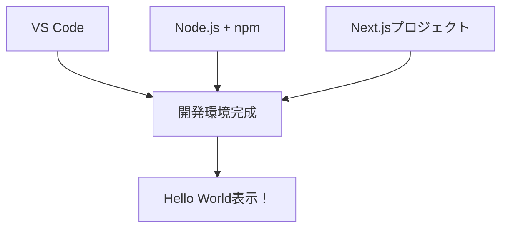

# Day 01: 開発環境を整えて、初めてのアプリを動かそう

## 今日のゴール

今日は、プログラミングを始めるための「土台作り」をします。料理に例えると、今日は「キッチンを整える」作業です。


今日の作業が終わると、ブラウザに「Hello World」が表示されます。ここから30日間の冒険が始まります！

---

## 今日学ぶこと

| 項目 | 説明 | 料理で例えると | 今日の必須度 |
|------|------|----------------|--------------|
| VS Code | コードを書くエディタ | まな板と包丁 | ✅ 必須 |
| Node.js | JavaScriptを動かすエンジン | ガスコンロ | ✅ 必須 |
| npm | パッケージ管理ツール | 食材配達サービス | ✅ 必須 |
| create-next-app | Next.jsプロジェクト作成ツール | レシピ本 | ✅ 必須 |
| Docker | 開発環境を統一するツール | 調理済みキット | ⏳ Day04で導入 |

---

## Step 1: VS Codeをインストールする（5分）

**このStepでできるようになること**: コードを書くためのエディタが使える状態になります。

VS Code（ブイエスコード：Visual Studio Code）は、プログラマーが使う「超高機能なメモ帳」です。コードを色分けして表示したり、間違いを指摘してくれたりします。

### インストール手順

1. ブラウザで [https://code.visualstudio.com/](https://code.visualstudio.com/) を開く
2. 「Download for Windows」または「Download for Mac」をクリック
3. ダウンロードしたファイルを実行してインストール

【スクリーンショット】VS Code公式サイトのダウンロードボタン

### インストール確認

インストールが完了したら、VS Codeを起動してください。以下のような画面が表示されれば成功です。

【スクリーンショット】VS Codeの初期画面（Welcome タブ）

```
確認ポイント:
- VS Codeが起動できた
- Welcome画面が表示された
```

---

## Step 2: VS Codeの日本語化（3分）

**このStepでできるようになること**: VS Codeのメニューが日本語で表示されます。

VS Codeを日本語で使えるようにしましょう。

### 日本語化手順

1. VS Codeの左側にある「Extensions」アイコン（四角が4つ並んだマーク）をクリック
2. 検索欄に「Japanese」と入力
3. 「Japanese Language Pack for Visual Studio Code」をクリック
4. 「Install」ボタンをクリック
5. 右下に表示される「Change Language and Restart」をクリック

【スクリーンショット】Japanese Language Packのインストール画面

```
確認ポイント:
- VS Codeが再起動した
- メニューが日本語になった
```

---

## Step 3: Node.jsをインストールする（5分）

**このStepでできるようになること**: JavaScriptをパソコン上で実行できるようになります。

Node.js（ノードジェイエス）は、JavaScriptをパソコン上で動かすための「エンジン」です。ブラウザの外でもJavaScriptが動くようになります。

### インストール手順

1. ブラウザで [https://nodejs.org/](https://nodejs.org/) を開く
2. 「LTS」と書かれた緑色のボタンをクリック（推奨版）
3. ダウンロードしたファイルを実行してインストール

| バージョン | 説明 | 選ぶべき？ |
|------------|------|-----------|
| LTS（推奨版） | 安定していて長期サポートあり | ✅ こちらを選ぶ |
| Current（最新版） | 最新機能があるが不安定な場合も | ❌ 初心者は避ける |

### インストール確認

VS Codeで「ターミナル」を開いて、バージョンを確認します。

1. VS Codeのメニューから「ターミナル」→「新しいターミナル」をクリック
2. 以下のコマンドを入力してEnterキーを押す

```bash
# filepath: ターミナル
# Node.jsのバージョンを確認するコマンド
node --version
```

```
確認ポイント:
- ターミナルが開いた
- 「v」で始まるバージョン番号が表示された（例：v20.x.x や v22.x.x など、数字は環境により異なります）
- エラーメッセージが出ていない
```

- エラーが出た場合は、末尾の「Q: `node --version`でエラーが出る」を参照してください

---

## Step 4: npmの動作を確認する（3分）

**このStepでできるようになること**: パッケージ管理ツールが使える状態になります。

npm（エヌピーエム：Node Package Manager）は、「図書館の司書さん」のようなツールです。必要なプログラムの部品（パッケージ）を自動的に探して、プロジェクトに入れてくれます。

Node.jsをインストールすると、npmも一緒にインストールされます。確認してみましょう。

```bash
# filepath: ターミナル
# npmのバージョンを確認するコマンド
npm --version
```

```
確認ポイント:
- バージョン番号が表示された（例：10.x.x など、数字は環境により異なります）
- エラーメッセージが出ていない
```

---

## Step 5: 作業フォルダを作成する（3分）

**このStepでできるようになること**: アプリを保存するためのフォルダが準備できます。

これから作るアプリを保存するフォルダを作りましょう。フォルダの場所は自由ですが、日本語や空白を含まない場所がおすすめです。

### ホームディレクトリの場所

| OS | ホームディレクトリの場所 |
|----|------------------------|
| Windows | C:\Users\あなたのユーザー名 |
| Mac/Linux | /Users/あなたのユーザー名 |

### フォルダ作成（Mac/Linux の場合）

```bash
# filepath: ターミナル（Mac/Linux）
# ホームディレクトリに移動
cd ~

# 開発用フォルダを作成
mkdir develop

# 作成したフォルダに移動
cd develop
```

```
確認ポイント（Mac/Linux）:
- developフォルダが作成された
- cdコマンドでdevelopフォルダに移動できた
```

### フォルダ作成（Windows PowerShell の場合）

```powershell
# filepath: ターミナル（Windows PowerShell）
# ホームディレクトリに移動
cd $HOME

# 開発用フォルダを作成
mkdir develop

# 作成したフォルダに移動
cd develop
```

```
確認ポイント（Windows）:
- developフォルダが作成された
- cdコマンドでdevelopフォルダに移動できた
```

---

## Step 6: Next.jsプロジェクトを作成する（5分）

**このStepでできるようになること**: アプリの骨組みが自動生成されます。

### 現在地の確認

このStepを始める前に、ターミナルがdevelopフォルダにいることを確認してください。Step 5で`cd develop`を実行していれば、現在地は `~/develop`（Mac/Linux）または `C:\Users\あなたのユーザー名\develop`（Windows）になっています。

### Next.jsとReactについて

Next.js（ネクストジェイエス：Reactベースのフルスタックフレームワーク）は、「高機能な料理キット」のようなものです。必要な道具や食材が全てセットになっていて、すぐに本格的な料理が作れます。

React（リアクト：UIを構築するためのJavaScriptライブラリ）は、「レゴブロック」のようなものです。小さな部品（コンポーネント）を組み合わせて、画面を作っていきます。

### プロジェクト作成コマンド

`create-next-app`というツールを使って、プロジェクトを自動生成します。

```bash
# filepath: ターミナル
# Next.jsプロジェクトを作成するコマンド
npx create-next-app@latest task-app
```

```
確認ポイント:
- 質問が表示された
- ログが流れ始めた
- task-app作成が開始された
- 赤いエラーメッセージが出ていない
```

### 質問への回答

コマンドを実行すると、いくつか質問されます。以下のように回答してください。

| 質問 | 回答 | 意味 | 今日この選択にする理由 |
|------|------|------|----------------------|
| Would you like to use TypeScript? | Yes | 型のあるJavaScriptを使う | エラーを事前に防げる |
| Would you like to use ESLint? | No | コード品質チェックツール | Biomeを優先し、必要な場合のみESLintを使うため |
| Would you like to use Tailwind CSS? | Yes | CSSフレームワークを使う | クラス名だけでデザインできる |
| Would you like your code inside a `src/` directory? | Yes | srcフォルダにコードを置く | ファイル整理がしやすい |
| Would you like to use App Router? | Yes | 最新のルーティングを使う | Next.js推奨の方式 |
| Would you like to use Turbopack? | Yes | 高速な開発サーバーを使う | 開発中の起動が速くなる |
| Would you like to customize the import alias? | No | デフォルト設定を使う | 初心者はデフォルトで十分 |

```
確認ポイント:
- 全ての質問に回答した
- 「Success!」のメッセージが表示された
- task-appフォルダが作成された
```

---

## Step 7: VS Codeでプロジェクトを開く（3分）

**このStepでできるようになること**: 作成したプロジェクトをVS Codeで編集できるようになります。

作成したプロジェクトをVS Codeで開きましょう。

### プロジェクトを開く

```bash
# filepath: ターミナル
# task-appフォルダに移動
cd task-app

# VS Codeでフォルダを開く
code .
```

```
確認ポイント:
- VS Codeで新しいウィンドウが開いた
- 左側のエクスプローラーにファイル一覧が表示された
```

`code .`コマンドは「現在のフォルダをVS Codeで開く」という意味です。ピリオド（.）は「今いる場所」を表します。

- `code`が見つからない等のエラーが出た場合は、末尾の「Q: `code .`コマンドが動かない」を参照してください

### フォルダ構造の確認

VS Codeの左側に、以下のようなフォルダ構造が表示されます。

| ファイル/フォルダ | 役割 |
|------------------|------|
| src/app/layout.tsx | 全ページ共通のレイアウト |
| src/app/page.tsx | トップページ |
| src/app/globals.css | 全体のスタイル |
| public/ | 画像などの静的ファイル |
| package.json | プロジェクト情報と依存関係 |

```
確認ポイント:
- srcフォルダが存在する
- package.jsonファイルが存在する
```

---

## Step 8: 開発サーバーを起動する（3分）

**このStepでできるようになること**: ブラウザでアプリを確認できる状態になります。

いよいよアプリを動かしてみましょう！開発サーバー（開発中だけ使う、自分のPC内で動くWebサーバー）を起動すると、作ったアプリをブラウザで確認できます。

### サーバー起動コマンド

VS Codeのターミナルで以下を実行します。

```bash
# filepath: ターミナル
# 開発サーバーを起動するコマンド
npm run dev
```

```
確認ポイント:
- 「Ready」のメッセージが表示された
- エラーメッセージが出ていない
- ターミナルが待機状態になっている
```

- エラーが出た場合は、末尾の「Q: `npm run dev`でエラーが出る」を参照してください

### 起動成功の確認

以下のようなメッセージが表示されれば成功です。

| 表示 | 意味 |
|------|------|
| Local: http://localhost:3000 | 自分のPC用アドレス |
| Network: http://192.168.x.x:3000 | 同じネットワーク内の他デバイス用 |
| Ready | サーバー起動完了 |

---

## Step 9: ブラウザでアプリを確認する（3分）

**このStepでできるようになること**: 開発中のアプリをブラウザで表示できます。

ブラウザを開いて、アプリが動いているか確認しましょう。localhost（ローカルホスト：自分のPC自身を指す特別なアドレス）にアクセスします。外部には公開されないので安心してください。

### アクセス方法

1. ブラウザ（Chrome推奨）を開く
2. アドレスバーに `http://localhost:3000` と入力
3. Enterキーを押す

【スクリーンショット】Next.jsの初期画面（Vercelロゴと「Get started by editing...」の表示）

Next.jsの初期画面が表示されれば、環境構築は成功です！

```
確認ポイント:
- ブラウザに画面が表示された
- Next.jsのロゴが見える
- 「Get started by editing src/app/page.tsx」と表示されている
```

---

## Step 10: 初めてのコード編集 - Hello Worldを表示する（5分）

**このStepでできるようになること**: コードを編集してブラウザの表示を変更できます。

動作確認ができたので、コードを編集してみましょう。`src/app/page.tsx`を開いて、内容を書き換えます。

### page.tsxを編集する

VS Codeの左側で `src/app/page.tsx` をクリックして開きます。ファイルの内容を全て削除して、以下のコードに置き換えてください。

```typescript
// filepath: src/app/page.tsx
// トップページを表示するコンポーネント
export default function Home() {
  return (
    <main className="p-8">
      {/* 見出しを表示 */}
      <h1 className="text-4xl font-bold">
        Hello World!
      </h1>
      {/* 説明文を表示 */}
      <p className="mt-4 text-gray-600">
        Task-Appへようこそ！30日間の冒険が始まります。
      </p>
    </main>
  );
}
```

```
確認ポイント:
- ファイルを保存した（Ctrl+S または Cmd+S）
- 保存するとブラウザが自動で更新された
- 「Hello World!」と表示された
```

### コードの解説

| コード | 意味 |
|--------|------|
| `export default function Home()` | このページのメイン部品を定義 |
| `<main>` | ページの主要コンテンツを囲むタグ |
| `className="p-8"` | 内側の余白を32px確保 |
| `text-4xl font-bold` | 文字を大きく太く表示 |
| `mt-4` | 上に余白を16px確保 |
| `text-gray-600` | 文字色をグレーに |

---

## Step 11: 開発サーバーの停止方法を覚える（2分）

**このStepでできるようになること**: 作業終了時にサーバーを正しく停止できます。

作業を終えるときは、開発サーバーを停止する必要があります。

### サーバーの停止方法

ターミナルで `Ctrl + C` を押します（Macも同じ）。

| 操作 | 説明 |
|------|------|
| Ctrl + C | サーバーを停止 |
| npm run dev | サーバーを再起動 |

```
確認ポイント:
- Ctrl + Cでサーバーが停止した
- ターミナルに新しいコマンドが入力できる状態になった
- ブラウザをリロードするとページが表示されなくなった
```

---

## 今日のまとめ

おめでとうございます！今日は開発環境の構築が完了しました。

### 今日やったこと



| 項目 | 状態 |
|------|------|
| VS Code | ✅ インストール完了 |
| Node.js | ✅ インストール完了 |
| npm | ✅ 動作確認完了 |
| Next.jsプロジェクト | ✅ 作成完了 |
| 開発サーバー | ✅ 起動確認完了 |
| Hello World | ✅ 表示成功！ |

### 今日覚えたコマンド

| コマンド | 意味 |
|---------|------|
| `node --version` | Node.jsのバージョン確認 |
| `npm --version` | npmのバージョン確認 |
| `npx create-next-app@latest` | Next.jsプロジェクト作成 |
| `npm run dev` | 開発サーバー起動 |
| `Ctrl + C` | サーバー停止 |

### Dockerについて

Dockerは、データベースを使い始めるDay04で導入します。今日の段階ではインストール不要です。

### 次回予告

明日は、作成したプロジェクトの構造を詳しく理解し、ページを追加していきます。今日作った土台の上に、少しずつ機能を積み重ねていきましょう！

---

## トラブルシューティング

### Q: `node --version`でエラーが出る

**原因**: Node.jsが正しくインストールされていないか、パスが通っていません。

**解決方法**:
- Node.jsを再インストールしてください
- インストール時に「Add to PATH」にチェックが入っているか確認してください
- ターミナルを閉じて開き直してください

### Q: `npm run dev`でエラーが出る

**原因**: `node_modules`フォルダがないか、破損している可能性があります。

以下の手順で解決できます。

#### 手順1: node_modulesフォルダを削除する（Mac/Linux）

```bash
# filepath: ターミナル（Mac/Linux）
# node_modulesフォルダを削除
rm -rf node_modules
```

```
確認ポイント（Mac/Linux）:
- node_modulesフォルダが削除された
- エラーメッセージが出ていない
```

#### 手順1: node_modulesフォルダを削除する（Windows PowerShell）

```powershell
# filepath: ターミナル（Windows PowerShell）
# node_modulesフォルダを削除
Remove-Item -Recurse -Force node_modules
```

```
確認ポイント（Windows）:
- node_modulesフォルダが削除された
- エラーメッセージが出ていない
```

#### 手順2: パッケージを再インストールする

```bash
# filepath: ターミナル
# パッケージを再インストール
npm install
```

```
確認ポイント:
- 「added xxx packages」のようなメッセージが表示された
- node_modulesフォルダが再作成された
```

#### 手順3: 開発サーバーを起動する

```bash
# filepath: ターミナル
# 開発サーバーを起動
npm run dev
```

```
確認ポイント:
- 「Ready」のメッセージが表示された
- http://localhost:3000 にアクセスできた
```

### Q: `code .`コマンドが動かない

**原因**: VS CodeのPATH設定がされていない可能性があります。

**解決方法**: コマンドパレットからPATH設定を行います。

| OS | コマンドパレットを開くキー | 実行する操作 |
|----|--------------------------|--------------|
| Mac | Cmd + Shift + P | 「Shell Command: Install 'code' command in PATH」を選択 |
| Windows | Ctrl + Shift + P | 「Shell Command: Install 'code' command in PATH」を選択 |
| Linux | Ctrl + Shift + P | 「Shell Command: Install 'code' command in PATH」を選択 |

設定後、ターミナルを閉じて開き直してから、再度`code .`を実行してください。

---

お疲れさまでした！明日も頑張りましょう！